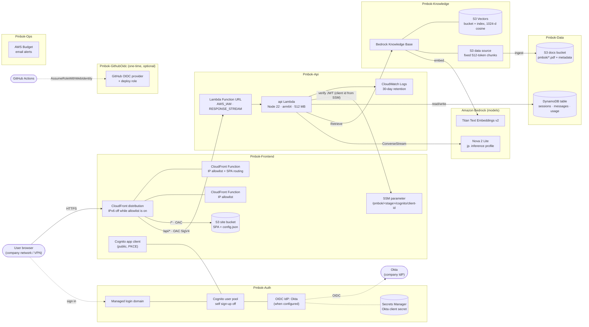
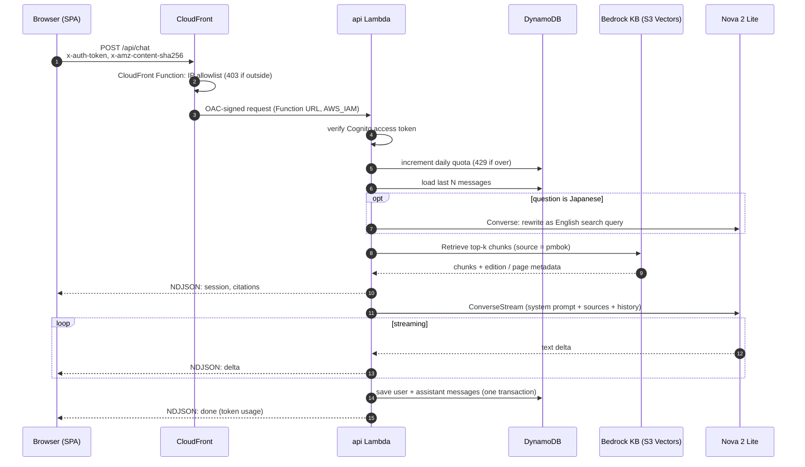
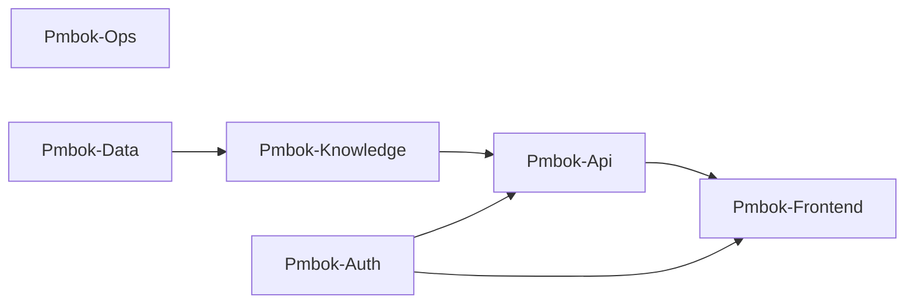

# Infrastructure Architecture

AWS infrastructure for the PMBOK Assistant POC, as defined by this CDK app (`ap-northeast-1`).
Design rationale lives in [`../docs/decisions.md`](../docs/decisions.md). The overall system view is in [`../docs/architecture.md`](../docs/architecture.md).

> Public repo: this file contains no account IDs, IPs or emails. Those come from `cdk.local.json` / GitHub variables.

## 1. Resources by stack

## 2. Chat request flow

## 3. Stack dependencies

Cross-stack references are weak (`Fn::GetStackOutput`, no exports), so always deploy and destroy with `--all`.
The Cognito app client lives in **Pmbok-Frontend** because its callback URL needs the CloudFront domain. The Lambda
reads the client id from SSM at runtime, which avoids a dependency cycle (ADR-006).
`Pmbok-GithubOidc` is only synthesized with `-c githubOidc=true` and is never part of `--all`.

## 4. Security boundaries

| Layer | Control |
|---|---|
| Network edge | CloudFront Functions allow only company egress IPs (`allowedIpCidrs`) on both `/*` and `/api/*`. IPv6 is disabled while the allowlist is active (ADR-012) |
| Origin access | S3 site bucket and Lambda Function URL accept **only** CloudFront OAC-signed requests. Function URL auth is `AWS_IAM` |
| Identity | Cognito (federated with Okta). The Lambda verifies access tokens on every request (`x-auth-token`) |
| Data isolation | Every DynamoDB key includes the caller's verified `sub` |
| Cost | Per-user daily question limit, `maxTokens` cap, AWS Budget email alerts |
| Least privilege | Lambda: one table, one KB, one SSM parameter, the configured model profiles only. CI role: may only assume the CDK bootstrap roles |
| No VPC | Nothing listens on a network we own; all services are IAM-authenticated over TLS (ADR-001) |

## 5. Where config comes from

| Value | Local deploy | GitHub Actions |
|---|---|---|
| Model id, budget email, Cognito domain prefix, allowed IPs, Okta | `infra/cdk.local.json` (git-ignored) | GitHub variables (`docs/cicd.md`) |
| Everything else | `infra/cdk.json` (committed defaults) | same |

Deploy with `npx cdk deploy --all -c strictConfig=true`. Strict mode refuses placeholders and an empty IP allowlist.
